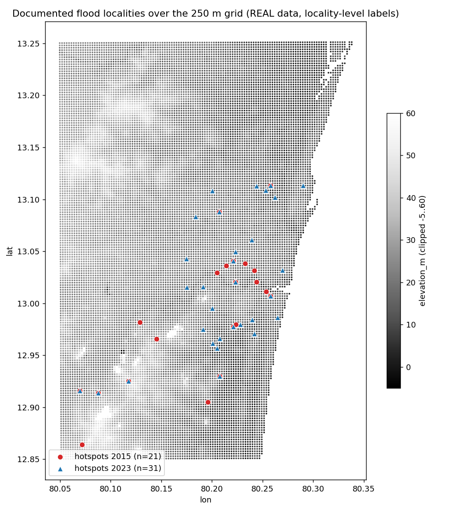

# Data QA

Generated 2026-10-29T21:15:18+05:30. All numbers come from the files in `data/processed/`. **Data source: real** (no SYNTHETIC.flag). Hotspot labels are locality-level points from news/report sources, not flood-extent maps.

## Files and row counts

- `features.parquet`: 18267 rows x 10 columns
- `hotspots.csv`: 52 rows ({'2015': 21, '2023': 31})
- `events.csv`: 2 events
- `rainfall.parquet`: 10560 rows, 20 points, 2015-11-27 23:00:00+05:30 to 2026-11-02 22:00:00+05:30

## Null checks

Columns with nulls: {}. Rainfall nulls: 0. Duplicate cell_ids: 0.

## Value ranges

| feature | min | mean | 50% | max |
|---|---|---|---|---|
| elevation_m | -20.165 | 16.691 | 15.636 | 149.292 |
| slope_deg | 0.000 | 1.880 | 1.756 | 22.010 |
| sink_depth_m | 0.000 | 0.256 | 0.097 | 41.288 |
| dist_drain_m | 0.503 | 881.366 | 690.974 | 4360.775 |
| dist_water_m | 0.503 | 554.144 | 475.986 | 2404.748 |
| road_density | 0.000 | 14.943 | 14.788 | 65.522 |
| built_up_frac | 0.000 | 0.407 | 0.336 | 1.000 |

Cells with elevation <= 0.5 m: 9. Cells within 25 m of mapped water (dist_water_m < 25): 1267.

Open-sea cells removed from the grid (WorldCover sea >= 50% of cell): 5051 of 23318; 18267 land cells remain.

dist_water_m source: ESA WorldCover 2021 classes 80+90 (25 m, >=50% water, sea removed) + OSM rivers/canals.

built_up_frac source: ESA WorldCover 2021 v200 (class 50).

## Hotspots

- event 2015: 22 localities listed, 22 geocoded inside the study area, 21 unique cells (0.115% of the grid).
- event 2023: 32 localities listed, 32 geocoded inside the study area, 31 unique cells (0.170% of the grid).
- Dropped (not found / outside area): none.
- Mean elevation of hotspot cells 13.8 m vs grid mean 16.7 m.
- Target was 40+ per event; fewer could be verified from credible sources (see SOURCES.md). Several localities share a cell, so unique cells are fewer than localities.

## Rainfall coverage

- event 2015 [2015-11-30T00:00:00+05:30 to 2015-12-03T00:00:00+05:30): 1440/1440 rows; mean window total over points 119 mm (max point 138 mm).
- event 2023 [2023-12-03T00:00:00+05:30 to 2023-12-06T00:00:00+05:30): 1440/1440 rows; mean window total over points 277 mm (max point 320 mm).
- forecast: data extends 97 h beyond the current hour (need >= 72).
- Historical rainfall is reanalysis (about 10-25 km): it understates extreme local rain (1 Dec 2015 reports say 300+ mm in 24 h; the grid-mean here is far lower).

## ML loaders (validate formats)

```
data_source = real
cells 18267 hotspot rows 52 event windows from events.csv (data owner)
rainfall rows 10560
(exit code 0)
```

## Map


