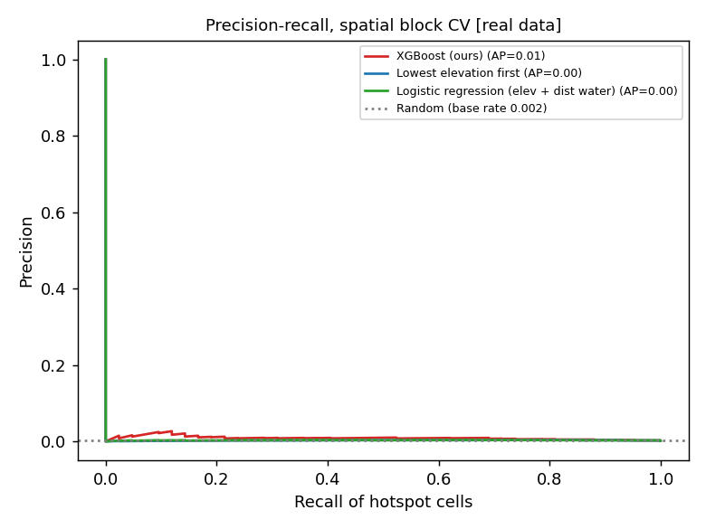
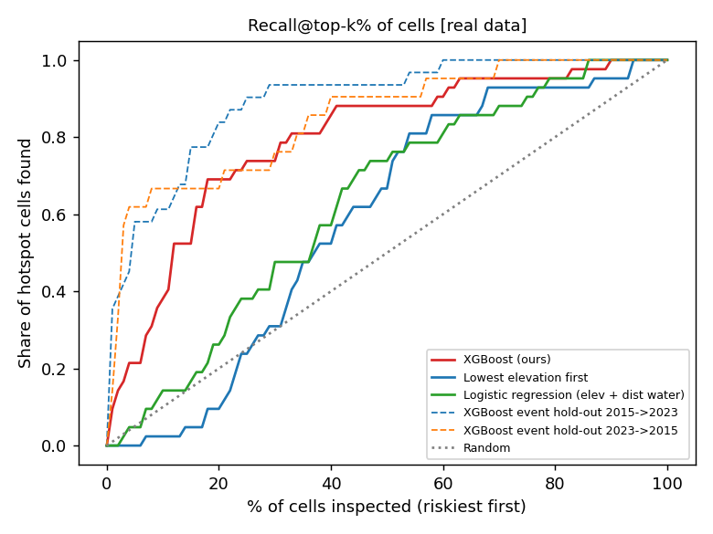

# VellamWatch ML backtest

- **Data source:** REAL (`data/processed`)
- **Cells:** 18267; hotspot cells: 42 (per event: {'2015': 21, '2023': 31}); base rate 0.002
- **Seed:** 42; model: XGBoost depth 3, 150 trees, monotone constraints (-1,-1,-1,1,0,0,0,0,0)
- **What is measured:** how well the susceptibility ranking puts known hotspot cells near the top. This is hotspot RANKING, not flood depth.

## A. Spatial block cross-validation

5 folds over ~2 km geographic blocks; training cells within 2 cells of any test cell are dropped. Pooled out-of-fold scores, all events' hotspots as positives.

| Model | PR-AUC | Recall@top 10% | Recall@top 20% | Lift@10% | Lift@20% | P@50 | P@100 | P@250 | P@500 |
|---|---|---|---|---|---|---|---|---|---|
| XGBoost (ours) | 0.010 | 38.1% | 69.0% | 3.81x | 3.45x | 0.000 | 0.010 | 0.020 | 0.014 |
| Lowest elevation first | 0.003 | 2.4% | 9.5% | 0.24x | 0.48x | 0.000 | 0.000 | 0.000 | 0.000 |
| Logistic regression (elev + dist water) | 0.003 | 14.3% | 26.2% | 1.43x | 1.31x | 0.000 | 0.000 | 0.000 | 0.002 |
| Random (mean of 20) | 0.003 | 9.5% | 18.9% | 0.95x | 0.95x | 0.003 | 0.003 | 0.002 | 0.002 |

## B. Event hold-out

Train on one event's hotspots only, test on the other event. 'New hotspots only' removes cells that were hotspots in the training event, so repeat flooding at known sites cannot inflate the score.

**Train 2015 -> test 2023, all test hotspots** (n_pos=31, base rate 0.002)

| Model | PR-AUC | Recall@top 10% | Recall@top 20% | Lift@10% | Lift@20% | P@50 | P@100 | P@250 | P@500 |
|---|---|---|---|---|---|---|---|---|---|
| XGBoost (ours) | 0.082 | 61.3% | 83.9% | 6.13x | 4.19x | 0.180 | 0.100 | 0.044 | 0.026 |
| Lowest elevation first | 0.002 | 3.2% | 12.9% | 0.32x | 0.65x | 0.000 | 0.000 | 0.000 | 0.000 |
| Logistic regression (elev + dist water) | 0.003 | 16.1% | 35.5% | 1.61x | 1.77x | 0.000 | 0.000 | 0.004 | 0.004 |
| Random (mean of 20) | 0.003 | 9.8% | 18.4% | 0.98x | 0.92x | 0.003 | 0.003 | 0.002 | 0.002 |

**Train 2023 -> test 2015, all test hotspots** (n_pos=21, base rate 0.001)

| Model | PR-AUC | Recall@top 10% | Recall@top 20% | Lift@10% | Lift@20% | P@50 | P@100 | P@250 | P@500 |
|---|---|---|---|---|---|---|---|---|---|
| XGBoost (ours) | 0.021 | 66.7% | 66.7% | 6.67x | 3.33x | 0.060 | 0.030 | 0.016 | 0.024 |
| Lowest elevation first | 0.001 | 0.0% | 4.8% | 0.00x | 0.24x | 0.000 | 0.000 | 0.000 | 0.000 |
| Logistic regression (elev + dist water) | 0.001 | 9.5% | 19.0% | 0.95x | 0.95x | 0.000 | 0.000 | 0.000 | 0.000 |
| Random (mean of 20) | 0.001 | 7.9% | 18.1% | 0.79x | 0.90x | 0.000 | 0.001 | 0.000 | 0.001 |

**Train 2015 -> test 2023, new hotspots only** (n_pos=21, base rate 0.001)

| Model | PR-AUC | Recall@top 10% | Recall@top 20% | Lift@10% | Lift@20% | P@50 | P@100 | P@250 | P@500 |
|---|---|---|---|---|---|---|---|---|---|
| XGBoost (ours) | 0.005 | 42.9% | 76.2% | 4.28x | 3.81x | 0.000 | 0.000 | 0.004 | 0.006 |
| Lowest elevation first | 0.002 | 4.8% | 14.3% | 0.48x | 0.71x | 0.000 | 0.000 | 0.000 | 0.000 |
| Logistic regression (elev + dist water) | 0.003 | 14.3% | 38.1% | 1.43x | 1.90x | 0.000 | 0.000 | 0.004 | 0.004 |
| Random (mean of 20) | 0.002 | 9.5% | 17.6% | 0.95x | 0.88x | 0.001 | 0.003 | 0.001 | 0.001 |

**Train 2023 -> test 2015, new hotspots only** (n_pos=11, base rate 0.001)

| Model | PR-AUC | Recall@top 10% | Recall@top 20% | Lift@10% | Lift@20% | P@50 | P@100 | P@250 | P@500 |
|---|---|---|---|---|---|---|---|---|---|
| XGBoost (ours) | 0.004 | 36.4% | 36.4% | 3.64x | 1.82x | 0.020 | 0.010 | 0.004 | 0.004 |
| Lowest elevation first | 0.001 | 0.0% | 0.0% | 0.00x | 0.00x | 0.000 | 0.000 | 0.000 | 0.000 |
| Logistic regression (elev + dist water) | 0.001 | 0.0% | 9.1% | 0.00x | 0.45x | 0.000 | 0.000 | 0.000 | 0.000 |
| Random (mean of 20) | 0.001 | 11.4% | 20.5% | 1.14x | 1.02x | 0.001 | 0.001 | 0.001 | 0.001 |

## C. Event replay through the budgeted rainfall stage

Stage 1 is trained on one event's hotspots only; the other event is replayed with as_of = start of its window, horizon 72 h. Rain severity sets how many cells are high; the stage-1 ranking picks which. **Recall** = share of the replayed event's hotspot cells in the HIGH band; **lift** = recall / share of all cells that are high (random = 1.0). The baseline flags the lowest-elevation cells using the SAME number of high cells. Rain stage: **policy targets, not fitted**.

| Train | Replay (as_of) | area rain24 (mm) | severity | high budget | hotspots | recall (ours) | recall (low-elev) | lift (ours) | lift (low-elev) | new-hotspot recall (ours / low-elev) |
|---|---|---|---|---|---|---|---|---|---|---|
| 2015 | 2023 (2023-12-03T00:00:00+05:30) | 223 | 1.00 | 40.0% | 31 | 93.5% | 54.8% | 2.34x | 1.37x | 90.5% / 61.9% (n=21) |
| 2023 | 2015 (2015-11-30T00:00:00+05:30) | 63 | 0.32 | 5.9% | 21 | 61.9% | 0.0% | 10.46x | 0.00x | 27.3% / 0.0% (n=11) |

Medium+high (same replay):

| Train | Replay | medium+high budget | recall (ours) | recall (low-elev) | lift (ours) | lift (low-elev) |
|---|---|---|---|---|---|---|
| 2015 | 2023 | 80.0% | 100.0% | 96.8% | 1.25x | 1.21x |
| 2023 | 2015 | 12.6% | 66.7% | 0.0% | 5.31x | 0.00x |

## D. Budget check

Share of ALL study-area cells per band for a 24 h rainfall total, for a uniform storm and a bursty storm (half of the total in the wettest 3 h). Bands: low < 0.33, medium < 0.66, high >= 0.66. The policy range is a TARGET set in `config.py` (not fitted); the high band is capped at 50%. Rain stage: **policy targets, not fitted**.

| 24 h rain (mm) | storm | wettest 3 h (mm) | severity | low | medium | high | policy range for high | in range |
|---|---|---|---|---|---|---|---|---|
| 0 | uniform over 24 h | 0.0 | 0.00 | 100.0% | 0.0% | 0.0% | 0%-0% | PASS |
| 0 | burst: half of it in 3 h | 0.0 | 0.00 | 100.0% | 0.0% | 0.0% | 0%-0% | PASS |
| 25 | uniform over 24 h | 3.1 | 0.06 | 98.0% | 2.0% | 0.0% | 0%-0% | PASS |
| 25 | burst: half of it in 3 h | 12.5 | 0.06 | 98.0% | 2.0% | 0.0% | 0%-0% | PASS |
| 50 | uniform over 24 h | 6.2 | 0.23 | 94.0% | 3.5% | 2.5% | 0%-3% | PASS |
| 50 | burst: half of it in 3 h | 25.0 | 0.23 | 94.0% | 3.5% | 2.5% | 0%-3% | PASS |
| 100 | uniform over 24 h | 12.5 | 0.56 | 70.0% | 15.0% | 15.0% | 10%-20% | PASS |
| 100 | burst: half of it in 3 h | 50.0 | 0.56 | 70.0% | 15.0% | 15.0% | 10%-20% | PASS |
| 150 | uniform over 24 h | 18.8 | 0.80 | 40.0% | 30.0% | 30.0% | 25%-35% | PASS |
| 150 | burst: half of it in 3 h | 75.0 | 0.80 | 40.0% | 30.0% | 30.0% | 25%-35% | PASS |
| 200 | uniform over 24 h | 25.0 | 0.98 | 20.0% | 40.0% | 40.0% | 35%-50% | PASS |
| 200 | burst: half of it in 3 h | 100.0 | 0.98 | 20.0% | 40.0% | 40.0% | 35%-50% | PASS |

- Light rain (< 15.6 mm) flags no medium or high cells: **PASS**
- Every cell's risk is non-decreasing as rainfall rises (0-400 mm): **PASS**
- Cell order by risk never changes with rainfall (rank-preserving): **PASS**

## E. Stage 2: budgeted ranking (policy targets, not fitted)

Rain severity (0-1) = max(severity of the 24 h total, severity of the wettest 3 h), averaged over the whole study grid. It sets the share of cells that are high / medium; the stage-1 susceptibility percentile (over the full grid, so a street keeps its rank in any viewport) decides which. risk_score is continuous: low [0, 0.33), medium [0.33, 0.66), high [0.66, 1], rising with susceptibility inside each band.

| 24 h rain (mm) | severity | high budget | medium+high budget |
|---|---|---|---|
| 15.6 | 0.00 | 0.0% | 0.0% |
| 25 | 0.06 | 0.0% | 2.0% |
| 50 | 0.23 | 2.5% | 6.0% |
| 64.5 | 0.33 | 6.2% | 13.2% |
| 100 | 0.56 | 15.0% | 30.0% |
| 115.6 | 0.67 | 21.6% | 43.2% |
| 150 | 0.80 | 30.0% | 60.0% |
| 200 | 0.98 | 40.0% | 80.0% |
| 204.5 | 1.00 | 40.0% | 80.0% |

- 24 h severity knots (IMD-style lower bounds, **verify**): 15.6 mm -> 0.00, 64.5 mm -> 0.33, 115.6 mm -> 0.67, 204.5 mm -> 1.00
- Wettest-3 h severity knots (heuristic, not IMD, **verify**): 10 mm -> 0.00, 40 mm -> 0.33, 70 mm -> 0.67, 120 mm -> 1.00
- Caps: high <= 50%, medium+high <= 80% of study-area cells.
- Event windows (start inclusive, end exclusive): 2015: 2015-11-30T00:00:00+05:30 to 2015-12-03T00:00:00+05:30, 2023: 2023-12-03T00:00:00+05:30 to 2023-12-06T00:00:00+05:30 (source: events.csv (data owner)).
- Nothing in this stage was tuned on synthetic data, and none of it is fitted to real data either.

## Plots

## Limitations

- **Label noise:** a cell not in hotspots.csv is treated as 'not a hotspot', but it may simply be unreported.
- **Only reported hotspots:** labels come from documented/news waterlogging sites, biased toward busy roads and well-reported areas.
- **Coarse rainfall:** Open-Meteo points are kilometres apart; street-level rain variation is invisible.
- **Few events:** at most two events, so rain sensitivity cannot be fitted; stage 2 uses policy targets.
- **Budgets are policy, not measurement:** the share of cells flagged at each rainfall level is a design choice (see `config.py`), so a high band does not mean a measured probability of flooding.
- **Study-area rainfall:** severity uses the mean forecast over the whole grid; a storm that hits only part of the city is under-weighted.
- **Reanalysis historical rainfall (~10 km) tends to understate extreme local rain; training and live forecast rainfall come from different sources.**
- **Ranking, not depth:** scores order cells by relative hotspot risk. They are not water depths, return periods or probabilities of flooding.
